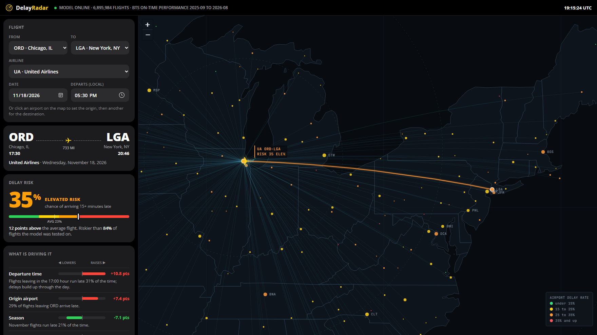

# DelayRadar: AI flight delay predictor

Enter a flight (airline, route, date, departure time) and get the chance it
arrives 15 or more minutes late, plus the factors behind that score.

The model is trained on the Bureau of Transportation Statistics
[Reporting Carrier On-Time Performance](https://www.transtats.bts.gov/DL_SelectFields.aspx?gnoyr_VQ=FGJ)
data: 6,895,984 US domestic flights from September 2025 through August 2026.



## Run it

```bash
python -m venv .venv
.venv/Scripts/python -m pip install -r requirements.txt
.venv/Scripts/python src/app.py
```

Then open http://localhost:5000. The trained model ships in `models/`, so the
app runs without downloading any data.

## Rebuild the model from scratch

```bash
.venv/Scripts/python src/download_data.py   # 12 monthly zip files from BTS (about 350 MB)
.venv/Scripts/python src/prepare.py         # clean and combine into data/flights.parquet
.venv/Scripts/python src/train.py           # train, evaluate, write models/
```

Training takes about one minute on a laptop.

## How it works

| File | Job |
| --- | --- |
| `src/download_data.py` | Downloads the monthly BTS files. |
| `src/prepare.py` | Keeps 21 of 109 columns, drops cancelled and diverted flights. |
| `src/features.py` | Builds the 12 model inputs. Shared by training and the app. |
| `src/train.py` | Trains the model, scores it against three baselines, saves everything. |
| `src/app.py` | Flask server: the prediction API and the web page. |
| `web/index.html` | The radar-style interface. |

**Target.** A flight counts as delayed if it arrives 15 or more minutes late,
the Department of Transportation definition.

**Inputs.** Airline, origin, destination, month, day of week, departure hour,
arrival hour, distance, days to the nearest travel holiday, flights per day on
the route, and how busy the origin and destination are in that hour. All of
them are known when a ticket is booked.

**Model.** Gradient-boosted decision trees (LightGBM), 169 trees.

**Explanations.** Each prediction is broken down with SHAP values, grouped into
eight factors and converted to percentage points of risk.

## Results

Scored on 1,059,469 flights from 55 days the model never saw during training.

| Method | AUC | Brier score |
| --- | --- | --- |
| Always predict the overall delay rate | 0.500 | 0.1757 |
| Airline's history on that route | 0.610 | 0.1709 |
| Logistic regression | 0.670 | 0.1644 |
| **Gradient-boosted trees** | **0.699** | **0.1601** |

The riskiest tenth of flights ran late 48% of the time; the safest tenth, 6%.
The scores are well calibrated: flights scored near 30% ran late 31% of the time.

## Limits

The model sees only the schedule. It knows nothing about weather, air traffic
control programs, or whether the inbound aircraft is running late, and late
inbound aircraft alone account for 40% of delay minutes in this data. Read the
score as "how risky is this kind of flight", not as a forecast for one day.
